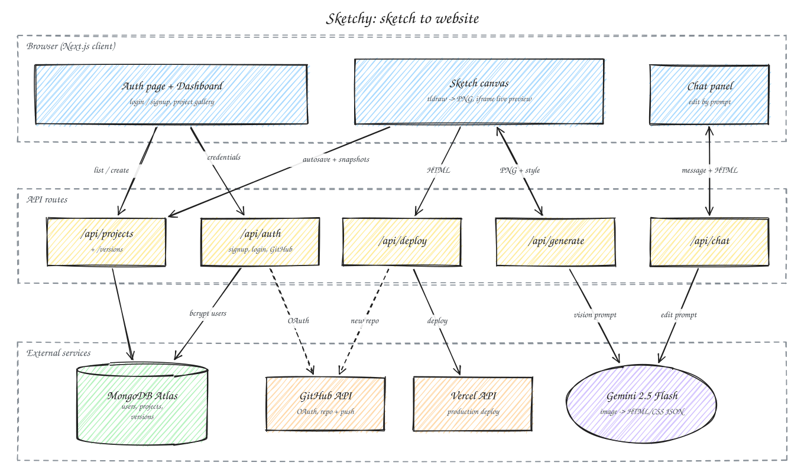

# Sketchy

Draw a wireframe, get a working website.

Sketchy turns hand-drawn interface sketches into live HTML and CSS. You sketch on a tldraw canvas, choose a design style and colours, and Gemini reads the drawing as an image and returns a complete page that renders right next to your canvas. You can then refine it by chatting, browse and restore earlier versions, download it, or deploy it to Vercel (optionally through a new GitHub repo) in one click.

- [Devpost](https://devpost.com/software/sketchy-8bnkyi)
- [Live website](https://www.sketchywebsite.tech)

> This repository is a fork of [abrj7/sketchy](https://github.com/abrj7/sketchy). All credit for the original project goes to the team listed under [Team](#team).

## Demo

<div style="display: flex; flex-wrap: wrap; gap: 10px;">
  
  
  
  
  
</div>

## Architecture



- **Auth page + Dashboard**: email/password sign-in or GitHub OAuth, then a project gallery with search. The dashboard lists and creates projects through `/api/projects`.
- **Sketch canvas**: a tldraw editor. On Generate it exports the shapes to a PNG and posts it, with the chosen style, background and accent colour, to `/api/generate`. The returned HTML/CSS renders in an `iframe` preview. Canvas state and a thumbnail autosave to `/api/projects/[id]` two seconds after the last edit, and each generation stores a snapshot under `/versions`.
- **Chat panel**: sends a plain-language edit request plus the current HTML to `/api/chat` and swaps in the updated page.
- **`/api/generate` and `/api/chat`**: build a style-specific prompt and call Gemini 2.5 Flash (`@google/generative-ai`) in JSON mode, returning `{ html, css, js }`.
- **`/api/projects` (+ `/versions`)**: Mongoose CRUD for projects and version snapshots, including restoring an earlier version.
- **`/api/auth`**: `signup` and `login` hash passwords with bcrypt and store users in MongoDB. `github/callback` exchanges the OAuth code for a token and keeps it in an HTTP-only cookie.
- **`/api/deploy`**: if GitHub push is selected, creates a public repo with the user's token and commits `index.html`, then deploys it to Vercel from that repo. Otherwise, or if that fails, it uploads the file straight to Vercel. It returns the production `*.vercel.app` URL.

## Features

- Freehand wireframing on an infinite tldraw canvas
- Sketch-to-website generation with six style presets (modern, minimalistic, dynamic, retro, glassmorphism, brutalist) plus custom background and accent colours
- Incremental regeneration: an existing page is sent back with the new sketch so only the changed parts are updated
- Live side-by-side preview in a resizable split pane
- Chat-based editing of the generated site
- Automatic version snapshots on every generation, with preview and restore
- Multiple projects per user with autosave, thumbnails, rename, delete and search (Cmd/Ctrl+K)
- Download the result as a single HTML file
- One-click deploy to Vercel, optionally pushing to a new GitHub repository first
- Email/password accounts (bcrypt) and GitHub OAuth
- Guided interactive tutorial and a support form (Formspree)

## Tech stack

- **Framework**: Next.js (App Router), React, TypeScript
- **Canvas**: [tldraw](https://tldraw.dev)
- **AI**: Google Gemini 2.5 Flash via `@google/generative-ai`
- **Database**: [MongoDB Atlas](https://www.mongodb.com/atlas) with Mongoose
- **Auth**: bcryptjs, [GitHub OAuth](https://docs.github.com/en/apps/oauth-apps/building-oauth-apps/authorizing-oauth-apps)
- **Deploy integration**: Vercel REST API, GitHub REST API
- **State and UI**: Zustand, CSS Modules, Lucide React

## Getting started

Requires Node.js and a MongoDB database.

```bash
npm install
cp .env.example .env   # then fill in the values
npm run dev            # http://localhost:3000
```

Production build:

```bash
npm run build
npm start
```

Environment variables read by the code:

| Variable | Used by |
| --- | --- |
| `GEMINI_API_KEY` | `/api/generate`, `/api/chat` |
| `MONGODB_URI` | `src/lib/mongodb.ts` (all project, version and auth routes) |
| `GITHUB_CLIENT_ID` | `/api/auth/github/callback` |
| `GITHUB_CLIENT_SECRET` | `/api/auth/github/callback` |
| `NEXT_PUBLIC_GITHUB_CLIENT_ID` | client-side GitHub sign-in redirect |
| `VERCEL_API_TOKEN` | `/api/deploy` |

Only `GEMINI_API_KEY` and `MONGODB_URI` are needed to sketch and generate. The GitHub and Vercel variables enable OAuth sign-in and deployment.

Note: the GitHub OAuth callback currently redirects to a hardcoded network address (`src/app/api/auth/github/callback/route.ts`). Change it to your own origin before using GitHub sign-in.

## Project structure

```
src/
  app/
    page.tsx              # view router: auth -> landing -> dashboard -> canvas
    api/
      generate/           # sketch PNG -> Gemini -> HTML/CSS
      chat/               # prompt-based edits via Gemini
      projects/           # project CRUD, [id]/versions snapshots and restore
      auth/               # signup, login, github/callback
      deploy/             # GitHub repo + Vercel deployment
      save/               # legacy Website save/list endpoint
  components/
    canvas/               # CustomCanvas (tldraw + preview), ChatPanel
    ui/                   # Dashboard, modals, user profile
    auth/                 # AuthPage
    tutorial/             # TutorialOverlay
  contexts/               # TutorialContext
  lib/                    # mongodb connection, auth helpers, Zustand store, Mongoose models
docs/                     # architecture diagram (architecture.json -> architecture.svg)
```

## Team

Sketchy was built by:

- Abdullah ([@abrj7](https://github.com/abrj7))
- Ali Imran
- Aidan Jeon ([@aidanjnn](https://github.com/aidanjnn))
- [@7kzaincode](https://github.com/7kzaincode)
